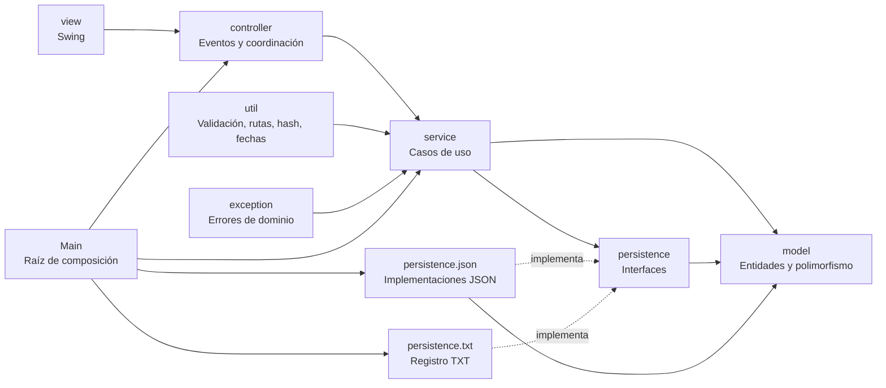

# Diagrama de clases detallado — Tienda Virtual de Libros

Este diagrama corresponde a los paquetes y clases actualmente implementados en `src/co/edu/uptc`. Las flechas de dependencia muestran la dirección prevista por la arquitectura SOLID: `view -> controller -> service -> persistence`, mientras que los servicios y repositorios trabajan sobre las entidades de `model`.

## Diagrama de paquetes y capas



## Diagrama de clases

```mermaid
classDiagram
    direction TB

    namespace co.edu.uptc {
        class Main {
            +main(String[] args)
        }
    }

    namespace model {
        class Producto {
            <<abstract>>
            -String codigo
            -String nombre
            -double precioBase
            -int stock
            -double porcentajeDescuento
            -double impuestoIVA
            +calcularPrecioSinIva() double
            +calcularPrecioFinal() double
            +calcularSubtotal(int cantidad) double
            +calcularImpuesto(int cantidad) double
            +hayStock(int cantidad) boolean
            +descontarStock(int cantidad)
            +reponerStock(int cantidad)
            +getDescripcionEntrega() String
        }
        class Libro {
            <<abstract>>
            -ArrayList~String~ autores
            -int anioPublicacion
            -Categoria categoria
            -String editorial
            -int numeroPaginas
            +getIsbn() String
            +getTitulo() String
            +getFormato() FormatoLibro
        }
        class LibroFisico {
            +getFormato() FormatoLibro
            +getDescripcionEntrega() String
        }
        class LibroDigital {
            +getFormato() FormatoLibro
            +getDescripcionEntrega() String
        }
        class LibroFactory {
            +crear(...) Libro
        }
        class Categoria {
            <<enumeration>>
            CIENCIA_FICCION
            HISTORIA
            TECNOLOGIA
            LITERATURA
            CIENCIA
            OTRA
        }
        class FormatoLibro {
            <<enumeration>>
            FISICO
            DIGITAL
        }
        class Usuario {
            <<abstract>>
            -String nombreCompleto
            -String correo
            -String contrasenaHash
            -Rol rol
        }
        class Cliente {
            <<abstract>>
            -String direccionEnvio
            -String telefono
            +calcularDescuento(double totalCompra) double
        }
        class ClienteRegular {
            +calcularDescuento(double) double
        }
        class ClientePremium {
            -double PORCENTAJE_DESCUENTO
            +calcularDescuento(double) double
        }
        class Administrador
        class Rol {
            <<enumeration>>
            ADMINISTRADOR
            CLIENTE
        }
        class Descontable {
            <<interface>>
            +calcularDescuento(double totalCompra) double
        }
        class LineaCompra {
            <<abstract>>
            -String isbn
            -String titulo
            -double precioBase
            -double porcentajeDescuento
            -double impuestoIVA
            -int cantidad
            +calcularPrecioSinIva() double
            +calcularSubtotal() double
            +calcularImpuesto() double
        }
        class ItemCarrito {
            +aumentar()
            +disminuir()
        }
        class LineaPedido
        class Carrito {
            -String correoCliente
            -ArrayList~ItemCarrito~ items
            +agregar(ItemCarrito)
            +buscar(String isbn) ItemCarrito
            +eliminar(String isbn)
            +vaciar()
            +getSubtotalGeneral() double
            +getTotalImpuestos() double
            +getTotalBruto() double
        }
        class Pedido {
            -long id
            -String fecha
            -String correoCliente
            -ArrayList~LineaPedido~ lineas
            -double subtotal
            -double impuestos
            -double descuento
            -double total
            -MetodoPago metodoPago
        }
        class MetodoPago {
            <<enumeration>>
            EFECTIVO
            TARJETA_CREDITO
            TARJETA_DEBITO
            PSE
        }
        class Resena {
            -String isbn
            -String correoCliente
            -int calificacion
            -String comentario
            -String fecha
        }
    }

    namespace exception {
        class TiendaException {
            <<exception>>
        }
        class ValidacionException
        class StockInsuficienteException
        class LibroDuplicadoException
        class LibroConVentasException
        class CredencialesInvalidasException
        class SesionNoIniciadaException
        class PersistenciaException
    }

    namespace persistence {
        class LibroRepository {
            <<interface>>
            +listar() List~Libro~
            +buscarPorIsbn(String) Optional~Libro~
            +guardar(Libro)
            +eliminar(String)
            +existe(String) boolean
        }
        class UsuarioRepository {
            <<interface>>
            +listar() List~Usuario~
            +buscarPorCorreo(String) Optional~Usuario~
            +guardar(Usuario)
        }
        class PedidoRepository {
            <<interface>>
            +listar() List~Pedido~
            +listarPorCliente(String) List~Pedido~
            +siguienteId() long
            +guardar(Pedido)
            +eliminar(long)
        }
        class CarritoRepository {
            <<interface>>
            +buscarPorCliente(String) Optional~Carrito~
            +guardar(Carrito)
            +eliminar(String)
        }
        class ResenaRepository {
            <<interface>>
            +listar() List~Resena~
            +guardar(Resena)
            +existeParaCliente(String,String) boolean
        }
        class RegistroOperaciones {
            <<interface>>
            +registrar(String nivel, String correo, String operacion)
        }
    }

    namespace persistence_json {
        class ArchivoJson {
            <<utility>>
            +leer(Path) List~Map~
            +escribir(Path,List~Map~)
        }
        class LibroJsonRepository
        class UsuarioJsonRepository
        class PedidoJsonRepository
        class CarritoJsonRepository
        class ResenaJsonRepository
    }

    namespace persistence_txt {
        class RegistroOperacionesTxt {
            -Path archivo
            +registrar(String,String,String)
        }
    }

    namespace service {
        class Sesion {
            -Usuario usuarioActual
            +iniciar(Usuario)
            +cerrar()
            +estaLogueado() boolean
            +exigirUsuario() Usuario
        }
        class AutenticacionService {
            -UsuarioRepository usuarios
            -RegistroOperaciones registro
            +registrarCliente(...) Cliente
            +iniciarSesion(...) Usuario
            +actualizarCliente(...) Cliente
        }
        class CatalogoService {
            -LibroRepository libros
            -PedidoRepository pedidos
            -RegistroOperaciones registro
            +listar() List~Libro~
            +buscar(String) Optional~Libro~
            +registrar(Libro)
            +actualizar(Libro)
            +eliminar(String)
        }
        class BusquedaService {
            -CatalogoService catalogo
            +buscarPorTexto(String) List~Libro~
        }
        class CarritoService {
            -LibroRepository libros
            -CarritoRepository carritos
            -RegistroOperaciones registro
            +cargar(String) Carrito
            +agregar(Carrito,String,int)
            +aumentar(Carrito,String)
            +disminuir(Carrito,String)
            +eliminar(Carrito,String)
            +vaciar(Carrito)
            +guardar(Carrito)
        }
        class PoliticaDescuentoAdicional {
            <<interface>>
            +calcularDescuento(Cliente,double,int) double
        }
        class DescuentoClienteFrecuente {
            -double PORCENTAJE
            +calcularDescuento(Cliente,double,int) double
        }
        class CompraService {
            -LibroRepository libros
            -PedidoRepository pedidos
            -CarritoRepository carritos
            -RegistroOperaciones registro
            -ReciboService recibos
            -Sesion sesion
            -PoliticaDescuentoAdicional politica
            +finalizarCompra(Carrito,MetodoPago) Pedido
            +registrarPedidoRapido(String,int,MetodoPago) Pedido
            +historialCliente() List~Pedido~
            +historialGlobal() List~Pedido~
            +cancelarPedido(long)
        }
        class ReciboService {
            -Path carpeta
            +generar(Pedido) String
        }
        class ResenaService {
            -ResenaRepository resenas
            -PedidoRepository pedidos
            -RegistroOperaciones registro
            +registrar(String,String,int,String) Resena
        }
    }

    namespace controller {
        class Comandos {
            <<utility>>
            +INICIAR_SESION
            +AGREGAR_CARRITO
            +REGISTRAR_PEDIDO
            +FINALIZAR_COMPRA
            +CANCELAR_PEDIDO
        }
        class LoginController
        class RegistroController
        class CatalogoController
        class TiendaController
        class CarritoController
        class HistorialController
        class PerfilController
        class ResenaController
        class ControladorPrincipal
    }

    namespace view {
        class LoginFrame
        class RegistroDialog
        class VentanaPrincipal
        class PanelTienda
        class PanelCarrito
        class PanelHistorial
        class PanelCatalogoAdmin
        class PanelPerfil
        class PanelResenas
        class ResumenPedidoDialog
        class ReciboDialog
        class Mensajes
    }

    namespace util {
        class Validador
        class FormatoMoneda
        class SeguridadHash
        class FechaUtil
        class Rutas
    }

    Producto <|-- Libro
    Libro <|-- LibroFisico
    Libro <|-- LibroDigital
    LibroFactory ..> Libro
    Libro ..> Categoria
    Libro ..> FormatoLibro
    Usuario <|-- Cliente
    Usuario <|-- Administrador
    Cliente <|-- ClienteRegular
    Cliente <|-- ClientePremium
    Descontable <|.. Cliente
    Usuario ..> Rol
    LineaCompra <|-- ItemCarrito
    LineaCompra <|-- LineaPedido
    Carrito o-- ItemCarrito
    Pedido o-- LineaPedido
    Pedido ..> MetodoPago

    TiendaException <|-- ValidacionException
    TiendaException <|-- StockInsuficienteException
    TiendaException <|-- LibroDuplicadoException
    TiendaException <|-- LibroConVentasException
    TiendaException <|-- CredencialesInvalidasException
    TiendaException <|-- SesionNoIniciadaException
    TiendaException <|-- PersistenciaException

    LibroRepository <|.. LibroJsonRepository
    UsuarioRepository <|.. UsuarioJsonRepository
    PedidoRepository <|.. PedidoJsonRepository
    CarritoRepository <|.. CarritoJsonRepository
    ResenaRepository <|.. ResenaJsonRepository
    RegistroOperaciones <|.. RegistroOperacionesTxt
    ArchivoJson ..> LibroJsonRepository
    ArchivoJson ..> UsuarioJsonRepository
    ArchivoJson ..> PedidoJsonRepository
    ArchivoJson ..> CarritoJsonRepository
    ArchivoJson ..> ResenaJsonRepository

    PoliticaDescuentoAdicional <|.. DescuentoClienteFrecuente
    Sesion o-- Usuario
    AutenticacionService --> UsuarioRepository
    AutenticacionService --> RegistroOperaciones
    CatalogoService --> LibroRepository
    CatalogoService --> PedidoRepository
    CatalogoService --> RegistroOperaciones
    BusquedaService --> CatalogoService
    CarritoService --> LibroRepository
    CarritoService --> CarritoRepository
    CarritoService --> RegistroOperaciones
    CompraService --> LibroRepository
    CompraService --> PedidoRepository
    CompraService --> CarritoRepository
    CompraService --> RegistroOperaciones
    CompraService --> ReciboService
    CompraService --> Sesion
    CompraService --> PoliticaDescuentoAdicional
    ResenaService --> ResenaRepository
    ResenaService --> PedidoRepository
    ResenaService --> RegistroOperaciones

    LoginController --> LoginFrame
    LoginController --> RegistroDialog
    LoginController --> AutenticacionService
    LoginController --> Sesion
    RegistroController --> RegistroDialog
    RegistroController --> AutenticacionService
    CatalogoController --> PanelCatalogoAdmin
    CatalogoController --> CatalogoService
    TiendaController --> PanelTienda
    TiendaController --> CarritoService
    TiendaController --> CompraService
    CarritoController --> PanelCarrito
    CarritoController --> CarritoService
    CarritoController --> CompraService
    HistorialController --> PanelHistorial
    HistorialController --> CompraService
    PerfilController --> PanelPerfil
    PerfilController --> AutenticacionService
    ResenaController --> PanelResenas
    ResenaController --> ResenaService
    ControladorPrincipal --> VentanaPrincipal
    ControladorPrincipal --> TiendaController
    ControladorPrincipal --> CarritoController
    ControladorPrincipal --> HistorialController
    ControladorPrincipal --> CatalogoController
    ControladorPrincipal --> PerfilController
    ControladorPrincipal --> ResenaController

    PanelTienda ..> Libro
    PanelCarrito ..> Carrito
    PanelHistorial ..> Pedido
    PanelCatalogoAdmin ..> Libro
    PanelResenas ..> Resena
    Main --> LibroJsonRepository
    Main --> UsuarioJsonRepository
    Main --> PedidoJsonRepository
    Main --> CarritoJsonRepository
    Main --> ResenaJsonRepository
    Main --> RegistroOperacionesTxt
    Main --> AutenticacionService
    Main --> CatalogoService
    Main --> CarritoService
    Main --> CompraService
    Main --> ResenaService
    Main --> LoginController
}
```

## Cómo visualizarlo

1. Abra este archivo en VS Code con una extensión Mermaid.
2. En GitHub, abra el archivo y use la vista renderizada del bloque Mermaid.
3. Copie el bloque `classDiagram` en [Mermaid Live](https://mermaid.live) para exportarlo a SVG o PNG.
4. El archivo fuente independiente está en `docs/DIAGRAMA_CLASES_ARQUITECTURA.mmd`.

## Lectura rápida de las dependencias

- `model` no depende de Swing, repositorios ni JSON.
- `service` depende de interfaces de `persistence` y de entidades de `model`.
- `persistence.json` implementa las interfaces y usa `ArchivoJson`.
- `controller` recibe vistas y servicios, y procesa eventos Swing.
- `view` solo dibuja componentes y expone datos para los controladores.
- `Main` realiza la inyección manual de dependencias.
