# Fase 0 — Diseño de la Tienda Virtual de Libros

## 1. Objetivo de la reorganización

El proyecto anterior funcionaba, pero concentraba entidades, repositorios, excepciones y servicios en un paquete `negocio`. Eso dificultaba explicar las responsabilidades y hacía menos visible la aplicación de SOLID.

La nueva versión se reconstruirá desde cero con una arquitectura por capas. Cada paquete representa una responsabilidad concreta y las dependencias apuntan hacia abstracciones:

```text
view  ->  controller  ->  service  ->  persistence (interfaces)
             |              |              ^
             +----------> model <----------+

persistence.json / persistence.txt implementan las interfaces de persistence.
util y exception son módulos de apoyo sin depender de Swing.
```

No se crea un paquete `interfaces` separado. Una interfaz de repositorio pertenece conceptualmente a la frontera de persistencia, por eso se ubica en `persistence`. Esto evita paquetes artificiales y mantiene juntas la abstracción y su propósito.

## 2. Árbol de carpetas final

```text
TiendaVirtualLibros/
├── .classpath
├── .project
├── .gitignore
├── README.md
├── lib/
│   └── gson-2.10.1.jar
├── data/
│   ├── libros.json
│   ├── clientes.json
│   ├── pedidos.json
│   ├── carritos.json
│   ├── resenas.json
│   ├── registro_operaciones.txt
│   └── recibos/
├── docs/
│   ├── FASE_0_DISENO.md
│   └── git/
│       ├── Producto_base.java
│       ├── Producto_estudiante_A.java
│       ├── Producto_estudiante_B.java
│       ├── Producto_conflicto.java
│       ├── Producto_resuelto.java
│       └── GUIA_CONFLICTO_GIT.md
└── src/
    └── co/edu/uptc/
        ├── Main.java
        ├── model/
        ├── exception/
        ├── persistence/
        │   ├── json/
        │   └── txt/
        ├── service/
        ├── controller/
        ├── view/
        └── util/
```

## 3. Responsabilidad de cada paquete

| Paquete | Responsabilidad | Puede importar | No debe importar |
|---|---|---|---|
| `model` | Entidades, reglas propias de las entidades, herencia y polimorfismo | Java estándar, `util` solo si una entidad lo necesita de forma justificada | Gson, Swing, repositorios, servicios |
| `exception` | Excepciones propias del dominio y persistencia | Java estándar | Swing, Gson, servicios |
| `persistence` | Interfaces de repositorio y contratos de almacenamiento | `model`, `exception` | Swing |
| `persistence.json` | Lectura/escritura JSON y adaptación polimórfica con Gson | `persistence`, `model`, `exception`, Gson | `view` |
| `persistence.txt` | Registro de operaciones en TXT | `persistence`, `exception`, Java estándar | Swing |
| `service` | Casos de uso y reglas que coordinan varias entidades | `model`, `exception`, interfaces de `persistence`, `util` | Swing, implementaciones JSON concretas |
| `controller` | Traduce eventos de la vista a llamadas de servicios | `view`, `service`, `model`, `exception` | Gson, acceso directo a archivos |
| `view` | Componentes Swing, formularios y presentación | Swing, DTO/modelo mínimo para pintar | Servicios, repositorios, Gson |
| `util` | Validación de formato, rutas, fechas, moneda y hash | Java estándar | Swing y reglas de negocio complejas |
| `Main` | Única raíz de composición e inyección manual de dependencias | Todos los paquetes | Estado global estático |

## 4. Modelo de clases

```mermaid
classDiagram
    class Producto {
        <<abstract>>
        -String codigo
        -String nombre
        -double precioBase
        -int stock
        -double porcentajeDescuento
        -double impuestoIVA
        +calcularPrecioSinIva() double
        +calcularPrecioFinal() double
        +calcularSubtotal(int) double
        +calcularImpuesto(int) double
        +hayStock(int) boolean
        +descontarStock(int)
        +reponerStock(int)
    }
    class Libro {
        <<abstract>>
        -ArrayList~String~ autores
        -int anioPublicacion
        -Categoria categoria
        -String editorial
        -int numeroPaginas
        +getIsbn() String
        +getTitulo() String
        +getFormato() FormatoLibro
        +getDescripcionEntrega() String
    }
    class LibroFisico
    class LibroDigital
    Producto <|-- Libro
    Libro <|-- LibroFisico
    Libro <|-- LibroDigital
    class LibroFactory
    LibroFactory ..> Libro

    class Usuario {
        <<abstract>>
        -String nombreCompleto
        -String correo
        -String contrasenaHash
        -Rol rol
    }
    class Cliente {
        <<abstract>>
        -String direccionEnvio
        -String telefono
        +calcularDescuento(double) double
    }
    class ClienteRegular
    class ClientePremium
    class Administrador
    Usuario <|-- Cliente
    Usuario <|-- Administrador
    Cliente <|-- ClienteRegular
    Cliente <|-- ClientePremium
    class Descontable {
        <<interface>>
        +calcularDescuento(double) double
    }
    Descontable <|.. Cliente

    class LineaCompra {
        <<abstract>>
        -String isbn
        -String titulo
        -double precioBase
        -double porcentajeDescuento
        -double impuestoIVA
        -int cantidad
        +calcularSubtotal() double
        +calcularImpuesto() double
    }
    class ItemCarrito
    class LineaPedido
    LineaCompra <|-- ItemCarrito
    LineaCompra <|-- LineaPedido
    class Carrito
    Carrito o-- ItemCarrito
    class Pedido
    Pedido o-- LineaPedido
    class Resena

    class LibroRepository {
        <<interface>>
    }
    class UsuarioRepository {
        <<interface>>
    }
    class PedidoRepository {
        <<interface>>
    }
    class CarritoRepository {
        <<interface>>
    }
    class ResenaRepository {
        <<interface>>
    }
    class LibroJsonRepository
    class UsuarioJsonRepository
    class PedidoJsonRepository
    class CarritoJsonRepository
    class ResenaJsonRepository
    LibroRepository <|.. LibroJsonRepository
    UsuarioRepository <|.. UsuarioJsonRepository
    PedidoRepository <|.. PedidoJsonRepository
    CarritoRepository <|.. CarritoJsonRepository
    ResenaRepository <|.. ResenaJsonRepository

    class CompraService
    class CatalogoService
    class CarritoService
    class AutenticacionService
    class ResenaService
    class PoliticaDescuentoAdicional {
        <<interface>>
        +calcularDescuento(Cliente, double, int) double
    }
    class DescuentoClienteFrecuente
    PoliticaDescuentoAdicional <|.. DescuentoClienteFrecuente
    CompraService --> LibroRepository
    CompraService --> PedidoRepository
    CompraService --> PoliticaDescuentoAdicional
    CatalogoService --> LibroRepository
    CarritoService --> CarritoRepository
    AutenticacionService --> UsuarioRepository
    ResenaService --> ResenaRepository
```



## 5. Reglas de dependencias

1. `model` no conoce persistencia, Swing ni Gson.
2. Los servicios reciben repositorios por constructor; nunca hacen `new LibroJsonRepository()` ni abren archivos.
3. Los controladores reciben servicios y vistas por constructor.
4. Las vistas no contienen cálculos de negocio ni acceden a JSON.
5. `Main` construye las implementaciones concretas y las inyecta.
6. Gson aparece únicamente en `persistence.json`.
7. Las excepciones de negocio viajan desde `service` hasta `controller`, donde se muestran con `JOptionPane`.
8. Las rutas de datos se definen una sola vez en `util.Rutas`.
9. La sesión será una instancia inyectada de `Sesion`, no un singleton ni una variable estática global.

## 6. Aplicación verificable de SOLID

| Principio | Evidencia planificada | Mejora frente al proyecto anterior |
|---|---|---|
| **S — Responsabilidad única** | `Producto` calcula reglas propias; `CatalogoService` coordina catálogo; `LibroJsonRepository` persiste libros; `PanelTienda` dibuja; `TiendaController` atiende eventos; `ReciboService` genera recibos | Se eliminan las clases todólogas del paquete `negocio` y se separan UI, negocio y datos |
| **O — Abierto/cerrado** | Nuevos formatos extienden `Libro`; nuevos clientes extienden `Cliente`; nuevas políticas implementan `PoliticaDescuentoAdicional`; nuevos repositorios implementan interfaces | `CompraService` no decide con cadenas ni depende de una clase JSON concreta |
| **L — Sustitución** | `LibroFisico` y `LibroDigital` cumplen el contrato de `Libro`; `ClienteRegular` y `ClientePremium` siempre devuelven un descuento entre 0 y el total | El código consumidor trabaja con abstracciones sin casos especiales |
| **I — Segregación** | Interfaces pequeñas: `LibroRepository`, `UsuarioRepository`, `PedidoRepository`, `CarritoRepository`, `ResenaRepository`, `RegistroOperaciones` | No existe un repositorio gigante con métodos que algunas clases no usan |
| **D — Inversión** | Servicios dependen de interfaces; `Main` inyecta implementaciones; la persistencia JSON puede reemplazarse por JDBC | La lógica no queda amarrada a `JsonUtil` ni a rutas concretas |

## 7. Trazabilidad de requisitos

| Requisitos | Clases y archivos responsables |
|---|---|
| RF-01 a RF-04 | `model.Libro`, `service.CatalogoService`, `controller.CatalogoController`, `view.PanelCatalogoAdmin`, `persistence.json.LibroJsonRepository` |
| RF-05 a RF-08 | `model.Usuario`, `model.Cliente`, `ClienteRegular`, `ClientePremium`, `service.AutenticacionService`, `controller.LoginController`, `RegistroController`, `PerfilController`, `HistorialController` |
| RF-09 a RF-15 | `model.Carrito`, `ItemCarrito`, `service.CarritoService`, `controller.CarritoController`, `view.PanelCarrito`, `Descontable` |
| RF-16 a RF-21 | `service.CompraService`, `service.ReciboService`, `exception.SesionNoIniciadaException`, `exception.StockInsuficienteException`, `view.ResumenPedidoDialog`, `view.ReciboDialog` |
| RF-22 a RF-25 | Interfaces en `persistence`, repositorios en `persistence.json`, `RegistroOperaciones` y `persistence.txt.RegistroOperacionesTxt` |
| RF-26 a RF-31 | `view.PanelTienda`, `controller.TiendaController`, `view.PanelHistorial`, `controller.HistorialController`, `service.CompraService` |
| RF-32 | `docs/git/Producto_base.java`, versiones A/B, conflicto, resolución y guía de comandos |
| RF-33 | `model.Resena`, `persistence.ResenaRepository`, `persistence.json.ResenaJsonRepository`, `service.ResenaService`, `controller.ResenaController`, `view.PanelResenas` |
| RF-34 | `service.PoliticaDescuentoAdicional`, `service.DescuentoClienteFrecuente`, inyección en `CompraService` |

## 8. Decisiones del prompt C.9

1. El precio base está antes de IVA y el impuesto se muestra aparte.
2. Existe un administrador con cuenta semilla y los clientes ven únicamente sus operaciones.
3. La autenticación usa correo y contraseña con SHA-256.
4. El cliente puede cambiar nombre, dirección, teléfono y contraseña, pero no correo ni tipo.
5. Cancelar un pedido lo elimina, repone stock y registra la operación.
6. El descuento del producto y el descuento del cliente se acumulan sobre el total bruto.
7. `Registrar Pedido` es una compra rápida de un solo libro y reutiliza `CompraService`.
8. La sesión se valida en el servicio, aunque la vista oculte acciones sin sesión.
9. La persistencia usará Gson 2.10.1 únicamente dentro de `persistence.json`.
10. Los valores monetarios serán `double` y los totales finales se redondearán al peso.
11. Los archivos de datos se crearán con semillas cuando no existan y se informará un archivo corrupto mediante `PersistenciaException`.
12. La política de cliente frecuente será aditiva: se inyectará como `PoliticaDescuentoAdicional` y aplicará 5 % desde el cuarto pedido registrado.

## 9. Orden de implementación

1. Fase 1: modelo y evidencia del conflicto de Git.
2. Fase 2: utilidades y excepciones.
3. Fase 3: interfaces e implementaciones de persistencia.
4. Fase 4: servicios y pruebas de negocio.
5. Fase 5: vistas Swing sin lógica de negocio.
6. Fase 6: controladores, eventos y `Main`.
7. Fase 7: integración, pruebas, README y revisión SOLID.
8. Fase 8: reseñas y descuento de cliente frecuente.

En cada fase se compilará el proyecto antes de avanzar. Los archivos temporales de pruebas quedarán en `.work` y no se mezclarán con `src`.
