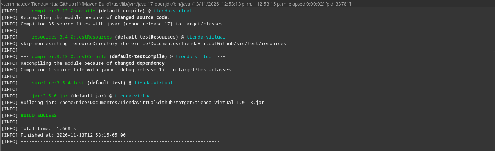
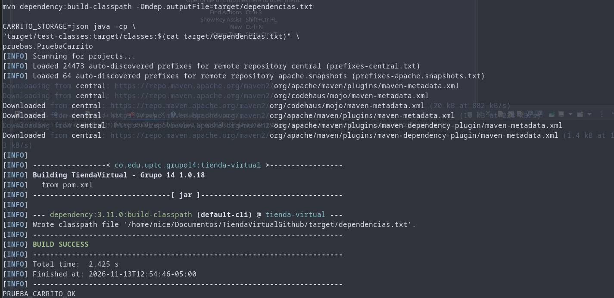
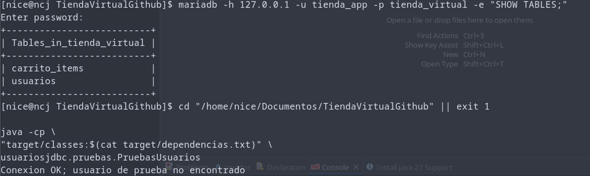
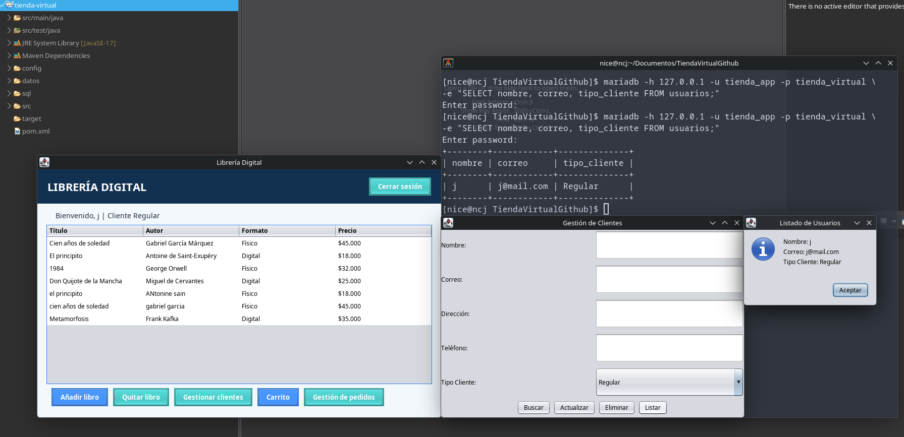
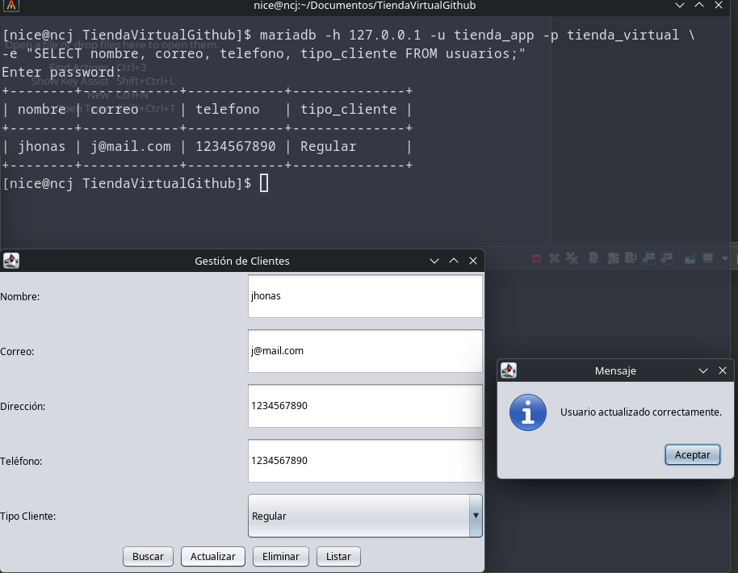
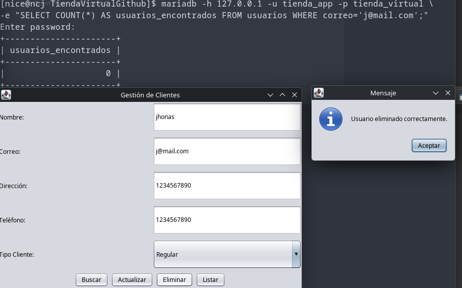
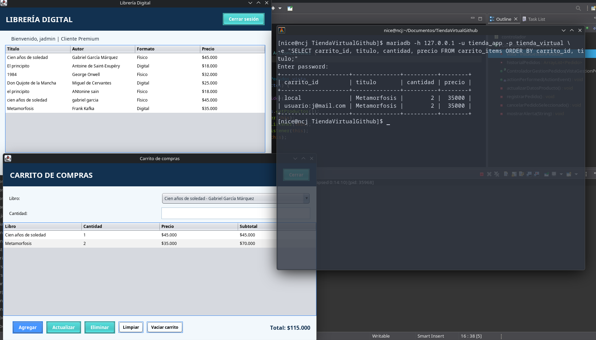
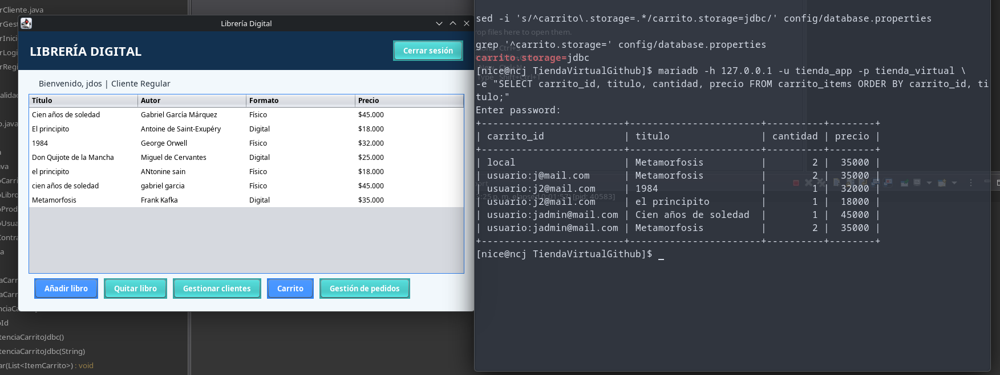

# Pruebas y evidencias

Pruebas realizadas en CachyOS con Java 17 y MariaDB. Las capturas corresponden a la versión previa a la corrección visual del título de Gestión de pedidos.

## 1. Compilación

`mvn clean verify` — `BUILD SUCCESS` (35 archivos fuente compilados).

## 2. Carrito JSON

`PRUEBA_CARRITO_OK` al ejecutar `pruebas.PruebaCarrito` con `CARRITO_STORAGE=json`.

## 3. Conexión JDBC

La consulta de prueba al módulo de usuarios devuelve `Conexion OK`.

## 4. Usuarios: consulta, actualización y eliminación

Consultas SQL y mensajes de la interfaz Swing con registros de prueba.

## 5. Carrito de compras

Cálculo de cantidades y total en Swing; en una prueba posterior se activó `carrito.storage=jdbc` y se observaron identificadores separados por correo en MariaDB.

La separación de contenido al iniciar sesión con dos usuarios fue reportada tras activar JDBC; las filas SQL respaldan el uso de identificadores independientes. Las capturas no sustituyen una prueba automatizada de extremo a extremo.

[🏠 Inicio Grupo 14](https://github.com/UPTC-DEVELOP/programacion_II/tree/feature/grupo14)
